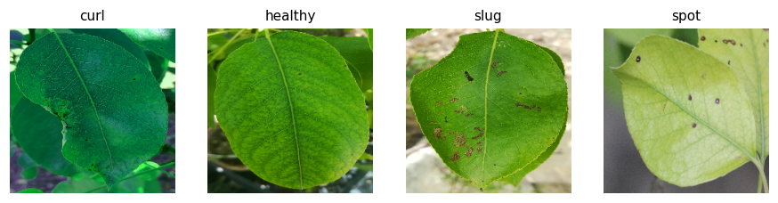
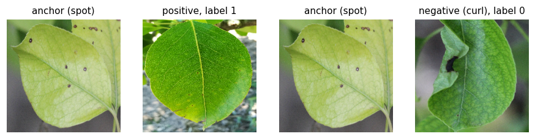
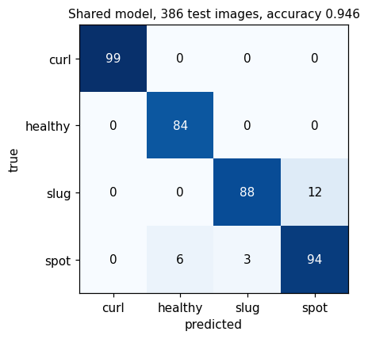
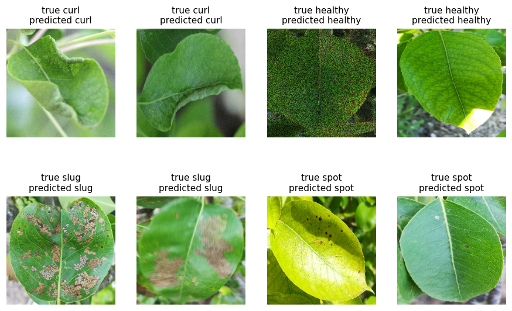
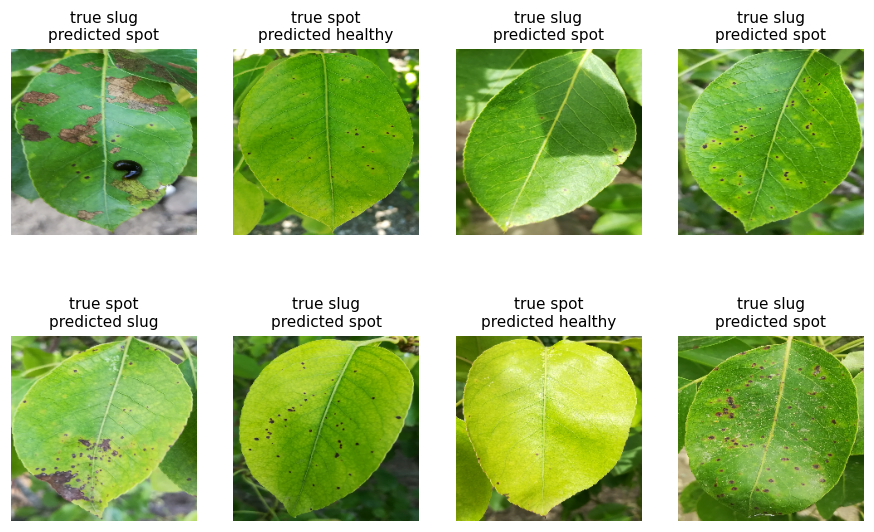
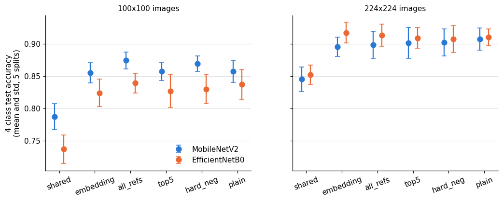
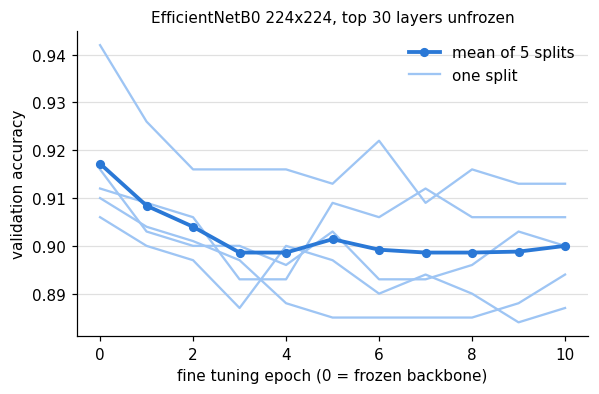

# Disease-Detection-Diamos

Pear leaf disease classification on the DiaMOS Plant dataset using Siamese networks.
A pretrained MobileNetV2 or EfficientNetB0 is used as a frozen feature extractor and only a small head on top is trained.

Classes: **curl**, **healthy**, **slug**, **spot**



There are two versions:

1. **Per class notebooks** (`MobileNetV2_<Class>.ipynb`, `EfficientNetB0_<Class>.ipynb`): the first version, one Siamese network per class on 100x100 images.
2. **Shared model** (`Siamese_AllClasses.ipynb`): one Siamese network for all 4 classes on 224x224 images. This is the better one, see the results below.

## How it works

### Per class notebooks

There is one Siamese network per class. It takes two leaf images and outputs a score between 0 and 1 for "both images are from this class".

Both images go through the same backbone. The absolute difference of the two feature maps is flattened and passed to a Dense layer with one sigmoid output.

- backbone: MobileNetV2 or EfficientNetB0 with ImageNet weights, frozen
- input size 100x100
- loss: binary cross entropy, Adam with learning rate 1e-4, batch size 16
- epochs: 20 for curl and healthy, 50 for slug, 30 for spot

Training pairs come from the `anchor`, `positive` and `negative` folders of each class:

- anchor + positive (same class) gives label 1
- anchor + negative (images of the other 3 classes) gives label 0



To classify a single leaf, `predict_per_class.py` runs all 4 models. Each one compares the leaf with 10 train images of its own class and the class with the highest average score is the prediction.

### Shared model

`Siamese_AllClasses.ipynb` has one network that answers "are these two leaves the same class" for any of the 4 classes:

- input size 224x224, EfficientNetB0 (frozen) with global average pooling
- both images go through the same Dense layer with 128 outputs (the embedding)
- the absolute difference of the two embeddings goes to a Dense layer with one sigmoid output
- every epoch uses 4000 new random pairs, half from the same class and half from different classes
- the positive of a pair is always a different leaf than the anchor
- 20% of the train leaves are kept for validation and the epoch with the best validation accuracy is kept (out of 40)

A leaf is classified by comparing it with every train image. The class with the highest average score wins.
`predict.py` does the same with the saved model and the saved embeddings of the train images.

## Dataset

Images are from DiaMOS Plant (Fenu and Malloci, Agronomy 2021), arranged like this:

```
King_Saud/
  Train/
    curl/     anchor/  positive/  negative/
    healthy/  anchor/  positive/  negative/
    slug/     anchor/  positive/  negative/
    spot/     anchor/  positive/  negative/
```

Curl and healthy have very few leaves in DiaMOS (54 and 43), so each of those leaves was saved as 10 augmented copies (brightness, colour, noise, rotation). Slug and spot images are separate photos.

`split_data.py` moves 20% of the **leaves** of each class to `King_Saud/Test`, keeping the same folder layout. All augmented copies of a leaf go to the same side, so the test set only has leaves the models never saw while training.

The dataset and the trained models are not in this repo (see `.gitignore`).

## Files

| File | What it does |
|------|--------------|
| `split_data.py` | makes the train/test split by leaf |
| `MobileNetV2_<Class>.ipynb` | trains and tests the per class Siamese network for one class with MobileNetV2 |
| `EfficientNetB0_<Class>.ipynb` | same with EfficientNetB0 |
| `predict_per_class.py` | uses the 4 per class models of a backbone together to classify a leaf |
| `Siamese_AllClasses.ipynb` | trains and tests the shared Siamese model |
| `predict.py` | classifies a leaf with the shared model |
| `experiments.py` | repeats the per class setup on 5 leaf splits and compares with a plain classifier |
| `siamese_experiments.py` | tries the changes of the shared model one at a time on the same 5 splits |
| `results/` | output of the two experiment scripts |
| `plot_results.py` | makes the figures in `images/` from the results and the saved shared model |

## How to run

```
pip install -r requirements.txt
```

1. Put the `King_Saud` folder next to the notebooks (on Colab, mount Drive and change `DATA_DIR` in the notebook).
2. Split once:
   ```
   python split_data.py
   ```
3. Run `Siamese_AllClasses.ipynb`. It saves `models/siamese_EfficientNetB0.h5` and `models/refs_EfficientNetB0.npz`.
4. Classify a leaf or test on all held out images:
   ```
   python predict.py leaf.jpg
   python predict.py --test
   ```
5. For the per class version run the 4 notebooks of a backbone (each one saves `models/<Backbone>_<Class>.h5`) and then:
   ```
   python predict_per_class.py leaf.jpg --backbone MobileNetV2
   python predict_per_class.py --test
   ```
6. Repeat on 5 leaf splits (uses Train and Test together and makes its own splits):
   ```
   python experiments.py
   python experiments.py --early-stop
   python siamese_experiments.py --size 100
   python siamese_experiments.py --size 224
   python siamese_experiments.py --size 224 --fine-tune
   ```
   The backbone features are computed once per run, so these take minutes except `--fine-tune`, which trains the backbone and takes a few hours on CPU.
7. Make the figures of this readme:
   ```
   python plot_results.py
   ```

## Results

All accuracies are 4 class accuracy on test leaves the model never saw. Numbers on a single split come from one training run, the 5 split tables show how much they move.

### Shared model, seed 42 split

`Siamese_AllClasses.ipynb` and `predict.py --test` (386 test images): **accuracy 0.946**



All mistakes are slug or spot leaves. The curl and healthy test images are 11 and 9 leaves with their augmented copies, so those rows are based on few real leaves.

Some test leaves it got right (2 random ones per class):



Some of the 21 mistakes (8 random ones). Most are slug leaves with small dark marks like the ones spot has. The spot leaves taken as healthy only have a few small marks:



### Per class notebooks, seed 42 split

Pair verification (test accuracy of each notebook):

| Backbone | curl | healthy | slug | spot |
|----------|------|---------|------|------|
| MobileNetV2 | 0.947 | 0.816 | 0.804 | 0.756 |
| EfficientNetB0 | 0.926 | 0.750 | 0.859 | 0.756 |

4 class classification with `predict_per_class.py --test`:

| Backbone | Accuracy |
|----------|----------|
| MobileNetV2 | 0.863 |
| EfficientNetB0 | 0.824 |

MobileNetV2 confusion matrix (rows = true class, columns = predicted):

|         | curl | healthy | slug | spot |
|---------|------|---------|------|------|
| curl    | 98 | 0 | 1 | 0 |
| healthy | 6 | 76 | 1 | 1 |
| slug    | 1 | 3 | 85 | 11 |
| spot    | 2 | 10 | 17 | 74 |

### Per class setup on 5 splits

`experiments.py` picks 5 different sets of test leaves (seed 42 is the split above plus seeds 1 to 4) and trains everything again on each one. It also trains a **plain classifier** on the same frozen backbone (Flatten and Dense with 4 softmax outputs) to see if the Siamese setup is worth it. Pairs, epochs and the 10 reference images are the same as in the notebooks and `predict_per_class.py`.

4 class test accuracy, mean and std over the 5 splits (100x100 images):

| Method | Fixed epochs | Early stopping |
|--------|--------------|----------------|
| Siamese MobileNetV2 | 0.810 +- 0.033 | 0.800 +- 0.018 |
| Siamese EfficientNetB0 | 0.785 +- 0.035 | 0.788 +- 0.031 |
| Plain MobileNetV2 | 0.862 +- 0.031 | 0.833 +- 0.021 |
| Plain EfficientNetB0 | 0.837 +- 0.028 | 0.830 +- 0.019 |

Fixed epochs are the notebook ones (20/20/50/30) and 30 for the plain classifier. With early stopping 20% of the train leaves are used as validation, training stops when the validation loss has not improved for 10 epochs (max 100) and the model is trained again on all train leaves for the best epoch count.

Recall per class with fixed epochs, mean over splits:

| Method | curl | healthy | slug | spot |
|--------|------|---------|------|------|
| Siamese MobileNetV2 | 0.941 | 0.858 | 0.782 | 0.672 |
| Plain MobileNetV2 | 0.941 | 0.841 | 0.832 | 0.833 |

The plain classifier was about 5 points better with both backbones and the McNemar test says the difference is real (p < 0.01) in 2 of the 5 splits for MobileNetV2 and 3 of 5 for EfficientNetB0. Most of the gap is on spot. Training the same Siamese model again on the same split also moved the result a lot (0.813 in `experiments.py` against 0.863 in the notebook on seed 42).

### Shared model step by step on 5 splits

`siamese_experiments.py` adds the changes of the shared model one at a time. Each row includes the rows above it. Epochs are picked on validation leaves, then the model is trained again on all train leaves and tested once.

4 class test accuracy, mean and std over the same 5 splits:

| Variant | MobileNetV2 100 | EfficientNetB0 100 | MobileNetV2 224 | EfficientNetB0 224 |
|---------|-----------------|--------------------|-----------------|--------------------|
| shared: one model, pooled features, 10 reference images per class | 0.787 +- 0.020 | 0.737 +- 0.022 | 0.845 +- 0.019 | 0.852 +- 0.015 |
| embedding: + 128 value embedding | 0.855 +- 0.016 | 0.824 +- 0.021 | 0.895 +- 0.015 | 0.917 +- 0.016 |
| all_refs: + compare with all train images | 0.874 +- 0.013 | 0.839 +- 0.015 | 0.898 +- 0.021 | 0.913 +- 0.017 |
| top5: average only the 5 best matches | 0.857 +- 0.014 | 0.827 +- 0.026 | 0.901 +- 0.024 | 0.909 +- 0.016 |
| hard_neg: hardest of 5 random negatives | 0.869 +- 0.012 | 0.830 +- 0.023 | 0.902 +- 0.021 | 0.907 +- 0.021 |
| plain classifier on the same features | 0.857 +- 0.017 | 0.837 +- 0.023 | 0.907 +- 0.017 | 0.910 +- 0.013 |



Fine tuning was tried with EfficientNetB0 at 224 on top of all_refs: the top 30 backbone layers unfrozen (batch norm kept frozen), random flips, rotation and brightness, learning rate 2e-5, 10 epochs of 2000 pairs. In all 5 splits the validation accuracy was highest before fine tuning started, so the frozen model was kept (test 0.910 +- 0.016 either way). Per epoch numbers are in `results/siamese_finetune.txt`.



### What this shows

- The learned embedding is the biggest single gain (5 to 9 points). Comparing raw backbone features with one Dense layer is not enough.
- 224x224 images help every variant, by 2 to 6 points with MobileNetV2 and 7 to 12 with EfficientNetB0. Slug and spot both show small dark marks that are hard to see at 100x100.
- After the embedding the other changes are inside the spread between splits. The notebook uses all_refs since it doesn't need a choice of reference images.
- The shared Siamese model now matches the plain classifier (about 0.91) but doesn't beat it. With these classes a softmax classifier on the same features is just as good.
- There is no clear winner between the backbones. MobileNetV2 is ahead at 100x100 and EfficientNetB0 at 224x224, by about the size of the spread between splits.
- Fine tuning the backbone did not help with about 1500 train images.
- Slug against spot is still where almost all mistakes are.

## Reference

G. Fenu and F. M. Malloci, "DiaMOS Plant: A Dataset for Diagnosis and Monitoring Plant Disease", Agronomy, 2021.
